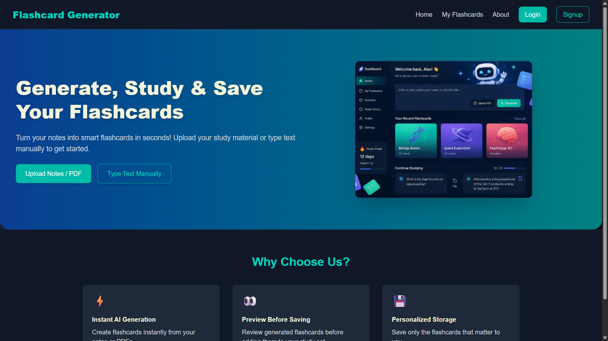
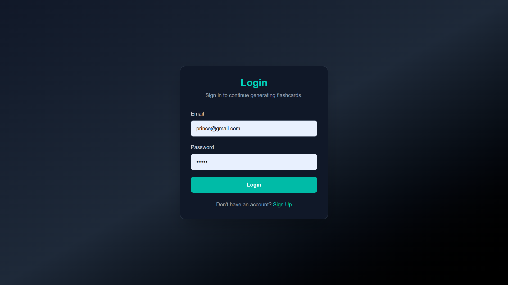
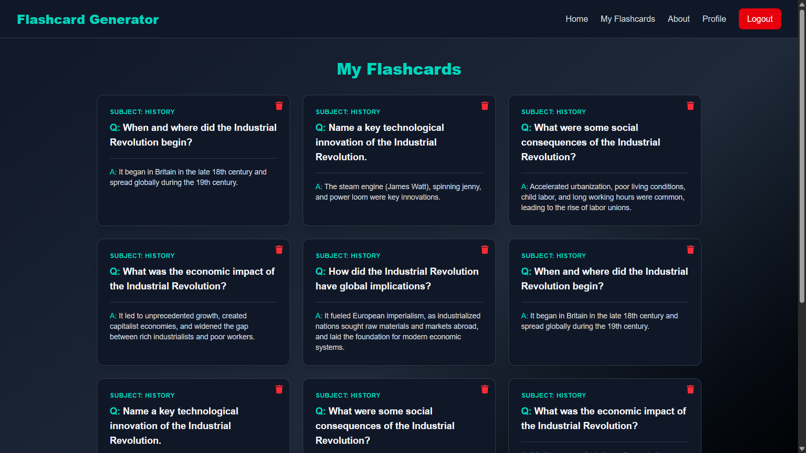
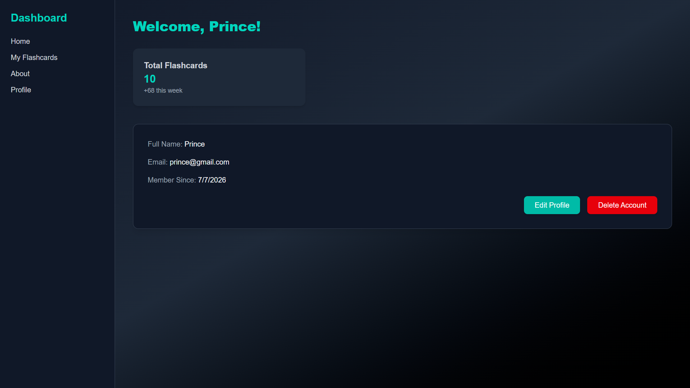
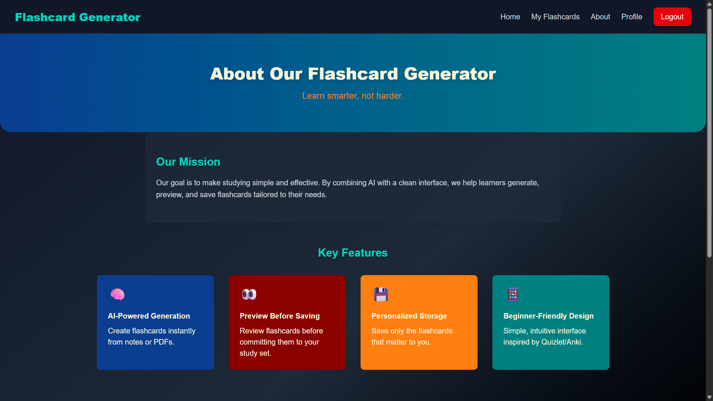

# 🧠 AI Flashcard Generator

An AI-powered flashcard generation platform that helps users create, organize, and study flashcards effortlessly. Built using Google Gemini AI to generate high-quality flashcards from any topic or prompt.

🔗 **Live Demo:** [ai-flashcard-app-amber.vercel.app](https://ai-flashcard-app-amber.vercel.app)  
🔗 **GitHub:** [github.com/prince728/AI-flashcard-App](https://github.com/prince728/AI-flashcard-App)

---

## 📸 Screenshots

### Landing Page


### Login


### My Flashcards


### Profile Dashboard


### About


---

## ✨ Features

- 🤖 AI-powered flashcard generation using Google Gemini API
- 🔐 Secure JWT Authentication with bcrypt password hashing
- 👤 User Registration & Login
- 📚 Create and manage personal flashcard decks
- ⚡ RESTful API backend
- 📱 Fully responsive React UI
- 🐳 Dockerized with Docker Compose support
- ☁️ MongoDB database integration

---

## 🛠️ Tech Stack

| Layer | Technology |
|---|---|
| Frontend | React 19, Vite, Tailwind CSS 4, React Router 7 |
| HTTP Client | Axios |
| Backend | Node.js, Express.js 5 |
| Database | MongoDB, Mongoose |
| AI | Google Gemini API |
| Auth | JWT, bcryptjs |
| DevOps | Docker, Docker Compose |

---

## 🏗️ Project Structure
```
AI-flashcard-App/
│
├── Backend/
│ ├── Dockerfile
│ ├── src/
│ │ ├── Controller/ # Auth and flashcard controllers
│ │ ├── Routes/ # API route definitions
│ │ ├── Models/ # Mongoose schemas
│ │ └── Middlewares/ # Auth middleware
│ ├── server.js
│ └── package.json
│
├── frontend/
│ ├── Dockerfile
│ ├── src/
│ │ ├── pages/ # Login, Signup, Dashboard
│ │ ├── components/ # Reusable UI components
│ │ └── services/ # API call functions
│ ├── public/
│ └── package.json
│
├── docker-compose.yml
└── README.md
```

---

## 🚀 Getting Started

### Prerequisites
- Node.js 18+
- Docker Desktop
- MongoDB Atlas account
- Google Gemini API key

### Run with Docker

```bash
git clone https://github.com/prince728/AI-flashcard-App
cd AI-flashcard-App
```

Create `Backend/.env`:
```env
PORT=5000
MONGO_URI=your_mongodb_connection_string
JWT_SECRET=your_jwt_secret
GEMINI_API_KEY=your_gemini_api_key
```

```bash
docker compose up --build
```

Stop containers:
```bash
docker compose down
```

### Local Development

**Backend:**
```bash
cd Backend
npm install
npm start
```

**Frontend:**
```bash
cd frontend
npm install
npm run dev
```

Open `http://localhost:5173`

---

## 🔌 API Endpoints

### Auth Routes
| Method | Endpoint | Description | Protected |
|--------|----------|-------------|-----------|
| POST | `/api/auth/signup` | Register new user | No |
| POST | `/api/auth/login` | Login and get JWT | No |

### Flashcard Routes
| Method | Endpoint | Description | Protected |
|--------|----------|-------------|-----------|
| POST | `/api/flashcard/generate` | Generate flashcards via AI | Yes |
| GET | `/api/flashcard/get-all` | Get all user flashcards | Yes |
| DELETE | `/api/flashcard/delete/:id` | Delete a flashcard | Yes |

---

## 🌐 Deployment

| Service | Provider | Purpose |
|---------|----------|---------|
| Frontend | Vercel | React app hosting |
| Backend | Render | Node.js API |
| Database | MongoDB Atlas | Cloud database |

---

## 💡 What I Learned

- Integrated Google Gemini AI API with structured prompts to generate meaningful flashcard content
- Built secure JWT authentication with bcrypt password hashing
- Dockerized both frontend and backend services with Docker Compose
- Designed a RESTful API with protected routes using JWT middleware
- Deployed a full-stack MERN application across multiple cloud providers

---

## 🔮 Future Improvements

- AI quiz mode with scoring
- Spaced repetition algorithm for smarter studying
- Flashcard sharing between users
- Progress tracking dashboard
- PDF export of flashcard decks

---

## 📄 License

MIT License

---

## 👨‍💻 Author

**Prince Gupta**  
[GitHub](https://github.com/prince728) • [LinkedIn](https://linkedin.com/in/prince-gupta2) • [LeetCode](https://leetcode.com/u/pCvTFwpDjV)

---

⭐ If you found this project useful, please give it a star!
